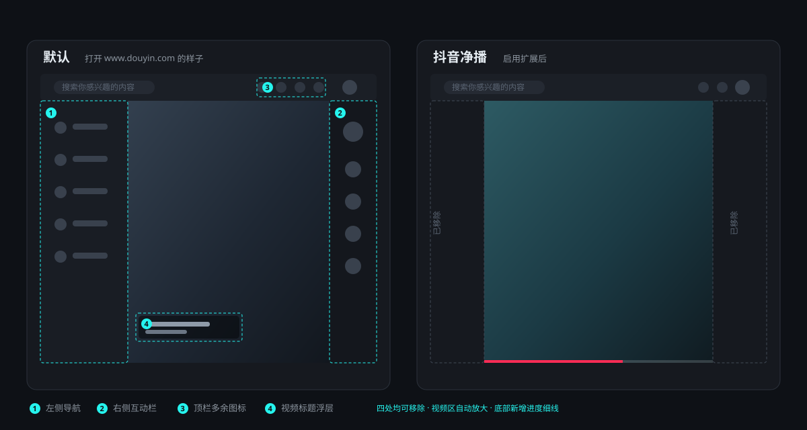
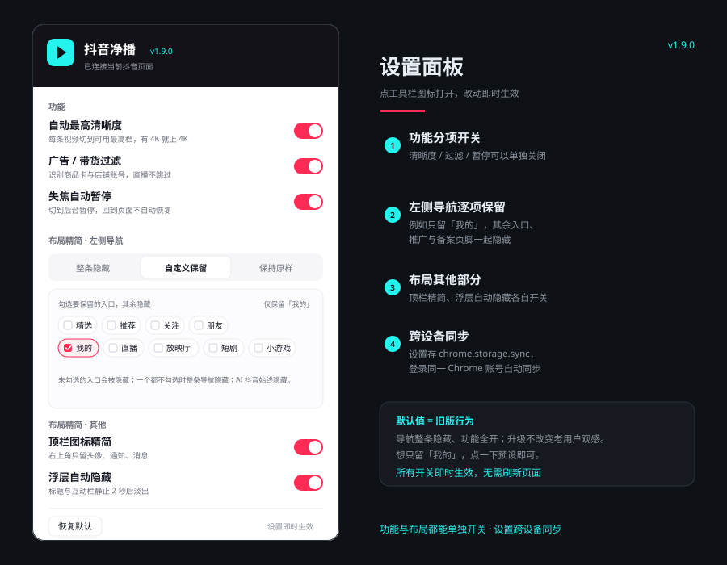

# 抖音净播 · Douyin Clean


当前版本：v2.1.0 · [下载 / Releases](https://github.com/XLNC-L/douyin-clean/releases) · [更新日志](CHANGELOG.md)



一个针对**网页版抖音**（`www.douyin.com` 与 `live.douyin.com`）的 Chrome 扩展：**自动最高清晰度**、**带货广告自动跳过**、**失焦暂停**、**纯净布局**、**视频底部进度细线**、**直播站精简**，所有功能都能在扩展面板里分项开关。不做列表轮询、不全站监听、不删 DOM 节点 —— 刷视频不卡。

## 最新变化（v2.1.0）

- **页面元素开关**：面板新增「页面元素」分组（默认折叠，标题旁是一键全选开关和展开箭头），17 项可独立隐藏 —— 顶栏、搜索框、作者信息、标题文案、商品卡片、AI、推荐标签、头像关注、点赞、评论、收藏、分享、更多、听抖音、控制条、原生进度、切换箭头；
- **评论区开关**：独立分组，同样折叠 + 总开关（总开关 = 隐藏全部），7 项可独立隐藏 —— AI tab、TA的作品、评论 tab、合集、相关推荐、热点、大家都在搜；七项全隐时评论列表自动上移贴顶，右上角关闭按钮始终保留；
- **只隐藏、不改结构**：给 `html` 挂 `dyc-h-<key>`，隐藏规则全走静态 CSS（`display: none`），不删节点、不拦事件，播放 / 切条 / 过滤 / 评论都不受影响；
- **默认全部不勾选**，保持抖音原样；勾选即隐藏，取消立即恢复，无需刷新。

## 最新变化（v2.0.7）

- **直播跳过修准**：`feed-live` 容器改为在整张活动卡片里找（卡片重渲染后它会变成兄弟层），再用覆盖面积把内嵌小窗排除，不再时灵时不灵；
- **判定窗口改为 60 秒**：前 12 秒高频复核（250/500ms），之后每 1 秒一次，直播容器晚出现也能抓到；
- **不再「连着几条直播后忽然不跳」**：连续直播上限 5 → 15 条，冷却 20 秒 → 10 秒；
- **「手动返回不再跳」不再误伤**：名单只由真实手势（向上滚轮 / ↑ / PageUp）写入，旧版误记的名单已清空——之前刷到后面直播和广告全都不跳，就是它导致的；
- **直播载入即暂停时也会跳**：直播命中改为强信号，不再等它恢复播放；
- **跳过更快、不跟手动操作抢**：判定复核收紧到 250/500ms、后台看门狗 1 秒；命中后排队切条的空档里只要检测到你用滚轮 / 按键 / 触摸操作，立刻收手；
- **修两处误跳**：`LivePlayer_*` 容器被复用不再把普通视频判成直播；店铺昵称（专营店 / 旗舰店等）不再单独判带货。

2.0.6 的清晰度上限与左侧栏抽屉见 [v2.0.6 发布说明](https://github.com/XLNC-L/douyin-clean/releases/tag/v2.0.6)，2.0.5 的顶栏与搜索页修复见 [v2.0.5 发布说明](https://github.com/XLNC-L/douyin-clean/releases/tag/v2.0.5)。

## 它解决什么问题

网页版抖音默认把体验做得很"满"：清晰度默认「智能」不会自己升到 4K、推荐流里混着带货视频、左侧导航和顶栏图标占地方、切到后台还在响。

这个扩展把这些一次性处理掉，并且**只在你刷视频时工作**，其他页面完全静默。

## 功能

| 功能 | 说明 |
| --- | --- |
| 分项设置面板 | 点工具栏图标打开，清晰度 / 过滤 / 暂停 / 布局各自开关，改动即时生效，无需刷新 |
| 自动最高清晰度 | 每条视频独立判定，自动选到该视频可用的最高档（有 4K 就上 4K），切换结果用 `videoWidth/videoHeight` 实测复验，不以菜单文字为准；面板可设上限（最高 / 1080P / 720P） |
| 带货 / 广告跳过 | 识别商品卡（含无「购物」字样的新型卡）、店铺账号（需同时有带货信号）、推广视频并自动切下一条 |
| 直播过滤 | 只跳过「当前视频本身是直播间」的卡片（直播播放器 / 直播时间标签 / 包住视频的直播链接或标记 / 覆盖画面 ≥60% 的 `feed-live` 容器）；换片后 60 秒内持续复核，容器晚出现也能抓到；作者正在直播不影响他的普通视频；可在面板单独关闭 |
| 手动返回不再跳 | 被自动跳过的广告 / 直播，用手势（向上滚轮 / ↑ / PageUp）滑回来后这一条不再自动跳过；名单存本机（最多 200 条），可在面板关闭 |
| 失焦自动暂停 | 窗口失焦或切到后台时暂停，回到页面**不会**自动恢复，不跟你抢播放控制 |
| 屏蔽双击点赞 | 双击画面不再点赞、不再飘心；单击暂停、拖动进度、按钮与控制条都不受影响 |
| 游戏推广卡片 | 左下角「游戏 XX」这类推广卡片直接隐藏，暂停后才出现的也会在 0.4s / 1.5s 内补隐藏；**独立于「浮层自动隐藏」**，浮层开着或关着都照样生效 |
| 浮层自动隐藏 | 标题文案、右侧互动栏、底部控制条：鼠标在画面内或移动时显示，静止 2 秒或移出 2 秒后淡出；**暂停瞬间整体收起，之后鼠标移动照常显示** |
| 左侧导航 | 四种模式：整条隐藏 / **抽屉**（左边缘悬停滑出）/ **逐项保留**（例如只留「我的」）/ 保持原样 |
| 顶栏精简 | 开关 + 自定义：默认只保留头像与搜索框，其余图标入口全部隐藏；可在「自定义」里勾选要留下的入口；关闭则保持原样，私信抽屉不受影响 |
| 视频进度细线 | 视频底边 3px 进度线，与标题/互动栏**相对**显隐（信息显示时隐藏、信息收起后显示）；隐藏「控制条」后改为常显（原生进度已不可见，关掉浮层也不会丢失）；时长拿不到时用 seekable / 播放器文案兜底；面板可开关、可换色，直播自动隐藏 |
| 直播间精简 | 开关 + 自定义（`live.douyin.com`）：可分别隐藏礼物栏 / 榜单入口 / 首页页脚 / 下载引导 / 顶栏推广；右侧聊天区、观众榜与播放器控制始终保留 |
| 手动屏蔽 | 面板里直接输入规则：普通文字按文案关键词匹配（标题 / 描述 / 话题里出现即跳过），以 `#` 开头的按话题精确匹配；规则以标签展示，可单条删除或一键清空。刷视频时按 `Alt + Shift + X` 仍可把当前视频的话题 / 作者写入规则库，再按一次取消 |
| 评论区 | 保持手动开关，打开 / 收起照旧 |

## 安装

### 方式一：下载 Release（推荐）

1. 打开 [Releases](https://github.com/XLNC-L/douyin-clean/releases/latest)，下载最新的 `douyin-clean-v*.zip`；
2. 解压到一个**固定目录**（之后不要删，Chrome 会一直从这里加载）；
3. 打开 `chrome://extensions`，右上角开启「开发者模式」；
4. 点「加载已解压的扩展程序」，选择解压后含 `manifest.json` 的那一层目录；
5. 打开 `https://www.douyin.com/` 即可生效；直播站 `https://live.douyin.com/` 同样适用（只做界面精简）。

升级：下载新 Release 覆盖原目录 → 扩展管理页点「刷新」→ 刷新抖音页面。

### 方式二：克隆仓库

```bash
git clone https://github.com/XLNC-L/douyin-clean.git
```

用「加载已解压的扩展程序」直接选择仓库目录。

## 设置

点工具栏的扩展图标打开设置面板。设置保存在 `chrome.storage.sync`，登录同一 Chrome 账号的设备会同步。



- **功能**：自动最高清晰度、广告 / 带货过滤、直播过滤、失焦自动暂停，各自独立开关；
- **播放进度条**：视频底部进度细线的开关、颜色（取色器 + 6 个预设色），改动即时生效；
- **布局精简 · 左侧导航**：
  - **整条隐藏**（默认，和旧版行为一致）；
  - **自定义保留**：面板会读取当前抖音页面的导航项（精选、推荐、AI抖音、关注、朋友、我的、直播、放映厅、短剧、小游戏），以及侧栏底部工具条里的「设置」，勾选要保留的入口，其余隐藏；侧栏里的「下载 APP」推广、备案 / 协议页脚也会一并隐藏；
  - **仅保留「我的」**：一键预设；
  - **保持原样**：不做任何处理；
  - 「AI 抖音」入口在以上三种模式下都强制隐藏，也不在保留候选项中；
- **布局精简 · 其他**：顶栏图标精简、浮层自动隐藏分别开关；
- 改动即时生效；如果刚更新扩展、内容脚本还没注入，刷新一次抖音页面即可。

> 自定义保留依赖抖音导航的 `tab-*` 语义类名（2026-10 实测仍在用）。如果抖音改版导致一个保留项都识别不到，扩展会放弃逐项隐藏，不会把整条导航清空。

## 为什么不会卡

刷抖音卡顿通常不是抖音本身，而是插件：全站 `MutationObserver(subtree)`、`setInterval` 轮询 `querySelectorAll`、运行时反复改样式触发重排。

本扩展的硬约束：

- **视觉改动全部写在静态 CSS**（[css/content.css](css/content.css)）；运行时唯一的样式写入是底部进度条的 `transform: scaleX()` 与一次性的颜色变量，前者走合成层、不触发重排；浮层标记与看门狗只读取少量几何信息；
- **换视频靠媒体事件驱动**（`loadedmetadata` / `playing` / `emptied`），另有一个 2 秒一次、只比对 `<video>` 引用与**卡片文案指纹**的轻量看门狗兜底，不做列表选择器轮询；
- **进度条由 `requestAnimationFrame` 逐帧读 `currentTime` 驱动**，不是 `setInterval` 轮询，也不用 `requestVideoFrameCallback`（拖动 / 跳转 / 切清晰度时它可能长时间不回调，线条会退化成"只会匀速走"）；页面隐藏时浏览器自动暂停该回调；
- **逐项隐藏左侧导航只在 custom / off 模式启用**，观察范围限定在 `#douyin-navigation` 内部（off 模式只用于维持「AI 抖音」强制隐藏），不观察整页；
- **不删 DOM 节点**：过滤只负责切到下一条，绝不动列表结构，虚拟列表与滚动吸附逻辑不受影响；
- **等待时用事件或有限次 `await sleep`**；扫描只在启动 / 换片时做，而且有数量上限。

## 调试

日常使用不需要调试：点工具栏图标就能分项开关。排查问题时在抖音页面按 **`Alt + Shift + D`**（`Ctrl + Shift + D` 被 Chrome 的「收藏所有标签页」占用，按键到不了页面）：

- 控制台打印当前状态：版本、播放器尺寸、清晰度档位、实测分辨率、广告判定、被隐藏的顶栏项；
- 给被隐藏 / 被标记的浮层加 2.5 秒青色描边，方便确认定位是否正确。

日志前缀为 `quality:`、`filter:` 与 `nav:`，例如：

```
[抖音净播] quality: 档位节点 6 个
[抖音净播] quality: 当前=智能 实测=1920p 最高档=超清 4K
[抖音净播] quality: 点档位 超清 4K
[抖音净播] quality: 实测已到 4K(3840)，本条视频不再调整
[抖音净播] filter: 识别到 购物卡片，跳过该视频
```

## 结构

```
manifest.json      MV3 声明：内容脚本、图标、设置面板、匹配规则
popup.html         设置面板界面
css/content.css    全部视觉改动（静态 CSS）
css/popup.css      设置面板样式
js/core.js         公共命名空间、选择器、工具函数、视频代次
js/defaults.js     设置默认值 + 归一化（内容脚本与 popup 共用）
js/settings.js     读取 / 监听 chrome.storage，向各模块广播
js/rules.js        手动屏蔽规则库（Alt + Shift + X 标记话题 / 作者）
js/nav.js          左侧导航：整条隐藏 / 抽屉 / 逐项保留，强制隐藏 AI 抖音
js/quality.js      自动最高清晰度（可设上限）
js/overlay.js      视频浮层显隐
js/filter.js       广告 / 带货过滤、直播跳过、直播小窗关闭
js/header.js       顶栏图标精简
js/progress.js     视频底部进度细线（逐帧更新 / 开关 / 换色）
js/live.js         直播站精简（礼物栏 / 榜单入口 / 页脚）
js/main.js         启动、新视频检测、失焦暂停、调试
js/health.js       启动自检 + 安全降级 + 诊断导出
js/popup.js        设置面板逻辑
scripts/check.mjs  静态校验（manifest / 版本 / 语法 / 文件引用）
docs/preview.svg   README 顶部的界面示意
docs/settings.svg  设置面板示意
CHANGELOG.md       逐版本改动记录
```

## 已知限制

- 适配 `www.douyin.com` 与 `live.douyin.com` 的桌面网页版；不支持手机网页版与抖音客户端；
- 两个站点的能力不同：信息流站点做清晰度 / 过滤 / 浮层 / 进度线 / 布局精简，直播站只做界面精简（礼物栏、榜单入口、页脚），不做清晰度与过滤；
- 抖音前端类名是哈希动态生成的，扩展只依赖 **ID / `data-e2e` / 几何特征 / 语义文本** 定位元素，大改版后可能需要跟进；
- 左侧导航的逐项保留依赖 `tab-*` 语义类名；导航项一个都认不出时会退回「不隐藏」，不会误伤；
- 清晰度受视频源限制：源本身没有 4K 时，抖音会把 4K 顺延到可用最高档，扩展接受这个结果，不会反复重试；
- 网页端播放器把同一条视频的多个清晰度当作「同一条视频」复用同一个 `<video>` 元素，因此扩展用「代次 + 文案指纹 + 卡片 / 封面旁证」而不是 `duration` / `src` 来判断换片；
- 进度线优先用 `video.duration`；MSE 点播读不到有限时长时会退到 `seekable` 或播放器总时长文案；直播等确实没有总时长的场景不显示进度线。

## 更新日志

每个版本的详细改动见 [CHANGELOG.md](CHANGELOG.md)；可下载的安装包见 [Releases](https://github.com/XLNC-L/douyin-clean/releases)。

## License

[MIT](LICENSE)
