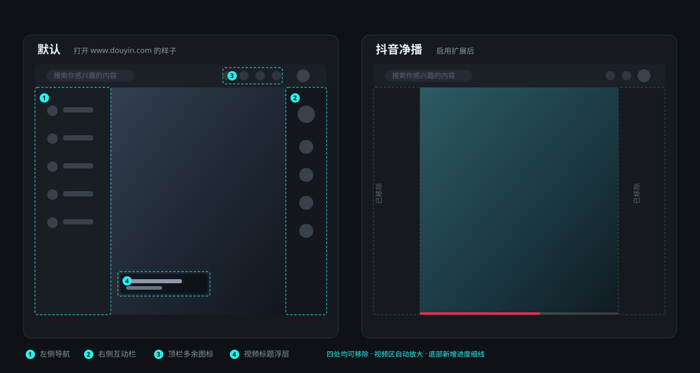
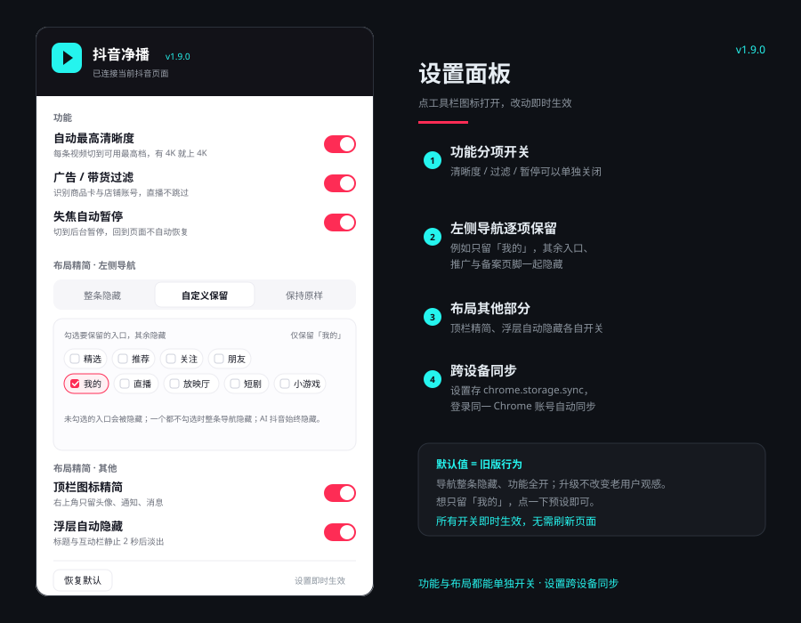

# 抖音净播 · Douyin Clean


当前版本：v1.9.0 · [下载 / Releases](https://github.com/XLNC-L/douyin-clean/releases) · [更新日志](CHANGELOG.md)



一个针对**网页版抖音**（`www.douyin.com`）的 Chrome 扩展：**自动最高清晰度**、**带货广告自动跳过**、**失焦暂停**、**纯净布局**、**视频底部进度细线**，所有功能都能在扩展面板里分项开关。不做列表轮询、不全站监听、不删 DOM 节点 —— 刷视频不卡。

## 最新变化（v1.9.0）

- **新增视频底部进度细线**：3px 细线贴在视频底边，控制条收起后也能看到播放进度；面板里可以单独关闭、换任意颜色，默认抖音红；
- 进度优先用 `requestVideoFrameCallback` 逐帧更新，退回 `timeupdate` 时用 CSS 线性过渡补齐，播放过程中只写一个 `transform`，不触发重排；
- 直播 / MSE 流等拿不到总时长的视频自动隐藏进度线；
- **「AI 抖音」入口强制隐藏**：左侧导航不论选「整条隐藏」「自定义保留」还是「保持原样」，该入口都不显示，也不再出现在面板的保留候选项里。

## v1.8.0

- **新增直播过滤**：推荐流里的直播间会自动切到下一条，可在面板里单独关闭；
- 直播判定优先看直播间链接、`LivePlayer_*` 播放器与 `live-room-* / livecard-* / web_live` 语义标记，再用控制条的「直播」时间标签和小尺寸徽标文案兜底；
- 明确排除了每个头像都带的 `live-avatar`，避免把普通视频误判成直播；
- 连续跳过 5 条直播后会暂停本轮过滤，防止推荐流全是直播时无限切视频；
- 移除面板右下角的「Alt + Shift + D 调试」提示（快捷键本身仍可用）。

## 它解决什么问题

网页版抖音默认把体验做得很"满"：清晰度默认「智能」不会自己升到 4K、推荐流里混着带货视频、左侧导航和顶栏图标占地方、切到后台还在响。

这个扩展把这些一次性处理掉，并且**只在你刷视频时工作**，其他页面完全静默。

## 功能

| 功能 | 说明 |
| --- | --- |
| 分项设置面板 | 点工具栏图标打开，清晰度 / 过滤 / 暂停 / 布局各自开关，改动即时生效，无需刷新 |
| 自动最高清晰度 | 每条视频独立判定，自动选到该视频可用的最高档（有 4K 就上 4K），切换结果用 `videoWidth/videoHeight` 实测复验，不以菜单文字为准 |
| 带货 / 广告跳过 | 识别商品卡（含无「购物」字样的新型卡）、店铺账号、推广视频并自动切下一条 |
| 直播过滤 | 识别推荐流中的直播间并自动切下一条；可在面板单独关闭 |
| 失焦自动暂停 | 窗口失焦或切到后台时暂停，回到页面**不会**自动恢复，不跟你抢播放控制 |
| 浮层自动隐藏 | 标题文案、右侧互动栏、底部控制条：鼠标在画面内或移动时显示，静止 2 秒或移出 2 秒后淡出；**暂停瞬间整体收起，之后鼠标移动照常显示** |
| 左侧导航 | 三种模式：整条隐藏 / **逐项保留**（例如只留「我的」）/ 保持原样 |
| 顶栏精简 | 三种模式：默认精简（只留头像/通知/消息）/ **自定义保留**（勾选要留的图标）/ 保持原样；私信抽屉不受影响 |
| 视频进度细线 | 视频底边常驻 3px 进度线，控制条收起后也能看到进度；面板可开关、可换色，直播自动隐藏 |
| 评论区 | 保持手动开关，打开 / 收起照旧 |

## 安装

### 方式一：下载 Release（推荐）

1. 打开 [Releases](https://github.com/XLNC-L/douyin-clean/releases/latest)，下载最新的 `douyin-clean-v*.zip`；
2. 解压到一个**固定目录**（之后不要删，Chrome 会一直从这里加载）；
3. 打开 `chrome://extensions`，右上角开启「开发者模式」；
4. 点「加载已解压的扩展程序」，选择解压后含 `manifest.json` 的那一层目录；
5. 打开 `https://www.douyin.com/` 即可生效。

升级：下载新 Release 覆盖原目录 → 扩展管理页点「刷新」→ 刷新抖音页面。

### 方式二：克隆仓库

```bash
git clone https://github.com/XLNC-L/douyin-clean.git
```

用「加载已解压的扩展程序」直接选择仓库目录。

## 设置

点工具栏的扩展图标打开设置面板。设置保存在 `chrome.storage.sync`，登录同一 Chrome 账号的设备会同步。



- **功能**：自动最高清晰度、广告 / 带货过滤、直播过滤、失焦自动暂停，各自独立开关；
- **播放进度条**：视频底部进度细线的开关、颜色（取色器 + 6 个预设色），改动即时生效；
- **布局精简 · 左侧导航**：
  - **整条隐藏**（默认，和旧版行为一致）；
  - **自定义保留**：面板会读取当前抖音页面的导航项（精选、推荐、AI抖音、关注、朋友、我的、直播、放映厅、短剧、小游戏），勾选要保留的入口，其余隐藏；侧栏里的「下载 APP」推广、备案 / 协议页脚也会一并隐藏；
  - **仅保留「我的」**：一键预设；
  - **保持原样**：不做任何处理；
  - 「AI 抖音」入口在以上三种模式下都强制隐藏，也不在保留候选项中；
- **布局精简 · 其他**：顶栏图标精简、浮层自动隐藏分别开关；
- 改动即时生效；如果刚更新扩展、内容脚本还没注入，刷新一次抖音页面即可。

> 自定义保留依赖抖音导航的 `tab-*` 语义类名（2026-10 实测仍在用）。如果抖音改版导致一个保留项都识别不到，扩展会放弃逐项隐藏，不会把整条导航清空。

## 为什么不会卡

刷抖音卡顿通常不是抖音本身，而是插件：全站 `MutationObserver(subtree)`、`setInterval` 轮询 `querySelectorAll`、运行时反复改样式触发重排。

本扩展的硬约束：

- **视觉改动全部写在静态 CSS**（[css/content.css](css/content.css)）；运行时唯一的样式写入是底部进度条的 `transform: scaleX()` 与一次性的颜色变量，前者走合成层、不触发重排；浮层标记与看门狗只读取少量几何信息；
- **换视频靠媒体事件驱动**（`loadedmetadata` / `playing` / `emptied`），另有一个 2 秒一次、只比对 `<video>` 引用与**卡片文案指纹**的轻量看门狗兜底，不做列表选择器轮询；
- **进度条由 `requestVideoFrameCallback` 逐帧驱动**（浏览器不支持时退回 `timeupdate`），不是 `setInterval` 轮询；暂停 / 页面隐藏时自然停止；
- **逐项隐藏左侧导航只在 custom / off 模式启用**，观察范围限定在 `#douyin-navigation` 内部（off 模式只用于维持「AI 抖音」强制隐藏），不观察整页；
- **不删 DOM 节点**：过滤只负责切到下一条，绝不动列表结构，虚拟列表与滚动吸附逻辑不受影响；
- **等待时用事件或有限次 `await sleep`**；扫描只在启动 / 换片时做，而且有数量上限。

## 调试

日常使用不需要调试：点工具栏图标就能分项开关。排查问题时在抖音页面按 **`Alt + Shift + D`**（`Ctrl + Shift + D` 被 Chrome 的「收藏所有标签页」占用，按键到不了页面）：

- 控制台打印当前状态：版本、播放器尺寸、清晰度档位、实测分辨率、广告判定、被隐藏的顶栏项；
- 给被隐藏 / 被标记的浮层加 2.5 秒青色描边，方便确认定位是否正确。

日志前缀为 `quality:`、`filter:` 与 `nav:`，例如：

```
[抖音净播] quality: 档位节点 6 个
[抖音净播] quality: 当前=智能 实测=1920p 最高档=超清 4K
[抖音净播] quality: 点档位 超清 4K
[抖音净播] quality: 实测已到 4K(3840)，本条视频不再调整
[抖音净播] filter: 识别到 购物卡片，跳过该视频
```

## 结构

```
manifest.json      MV3 声明：内容脚本、图标、设置面板、匹配规则
popup.html         设置面板界面
css/content.css    全部视觉改动（静态 CSS）
css/popup.css      设置面板样式
js/core.js         公共命名空间、选择器、工具函数、视频代次
js/defaults.js     设置默认值 + 归一化（内容脚本与 popup 共用）
js/settings.js     读取 / 监听 chrome.storage，向各模块广播
js/nav.js          左侧导航：整条隐藏 / 逐项保留，强制隐藏 AI 抖音
js/quality.js      自动最高清晰度
js/overlay.js      视频浮层显隐
js/filter.js       广告 / 带货过滤、直播小窗关闭
js/header.js       顶栏图标精简
js/progress.js     视频底部进度细线（逐帧更新 / 开关 / 换色）
js/main.js         启动、新视频检测、失焦暂停、调试
js/popup.js        设置面板逻辑
scripts/check.mjs  静态校验（manifest / 版本 / 语法 / 文件引用）
docs/preview.svg   README 顶部的界面示意
docs/settings.svg  设置面板示意
CHANGELOG.md       逐版本改动记录
```

## 已知限制

- 只适配 `www.douyin.com` 桌面网页版，不支持手机网页版与抖音客户端；
- 抖音前端类名是哈希动态生成的，扩展只依赖 **ID / `data-e2e` / 几何特征 / 语义文本** 定位元素，大改版后可能需要跟进；
- 左侧导航的逐项保留依赖 `tab-*` 语义类名；导航项一个都认不出时会退回「不隐藏」，不会误伤；
- 清晰度受视频源限制：源本身没有 4K 时，抖音会把 4K 顺延到可用最高档，扩展接受这个结果，不会反复重试；
- 网页端播放器把同一条视频的多个清晰度当作「同一条视频」复用同一个 `<video>` 元素，因此扩展用「代次 + 文案指纹 + 卡片 / 封面旁证」而不是 `duration` / `src` 来判断换片；
- 进度线依赖视频的 `duration`；直播、MSE 流等总时长未知的场景不显示进度线，这是预期行为。

## 更新日志

每个版本的详细改动见 [CHANGELOG.md](CHANGELOG.md)；可下载的安装包见 [Releases](https://github.com/XLNC-L/douyin-clean/releases)。

## License

[MIT](LICENSE)
